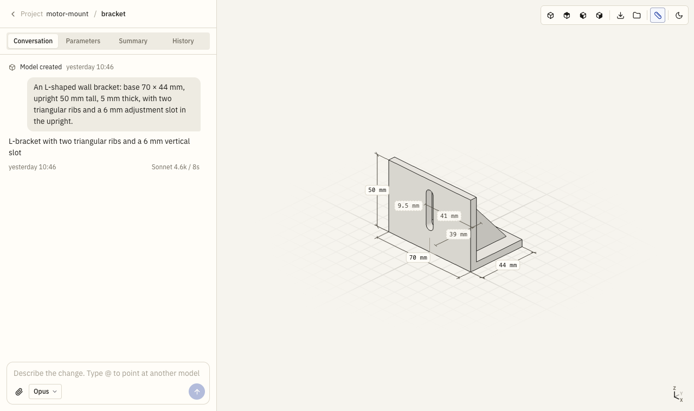
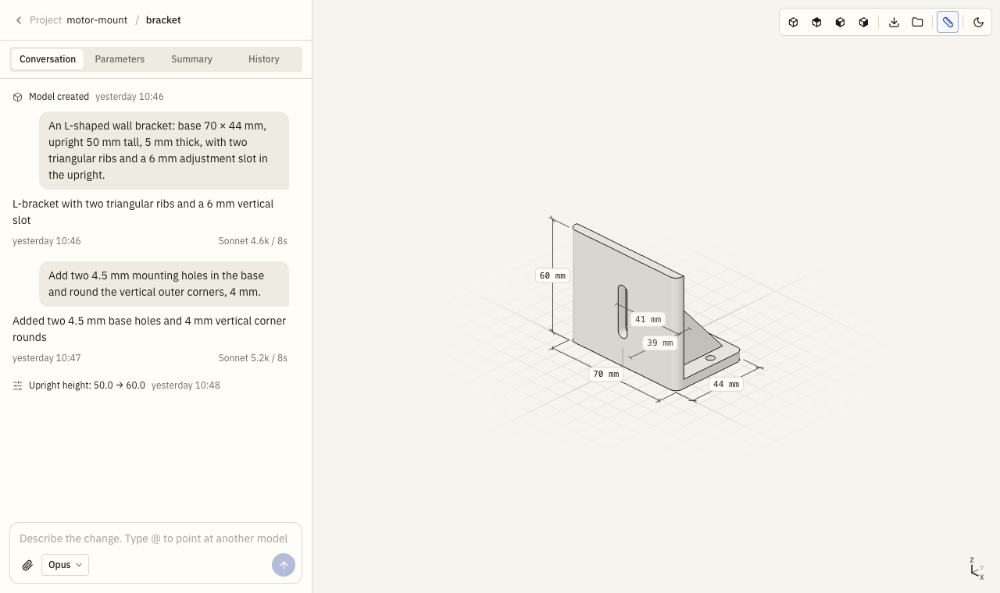
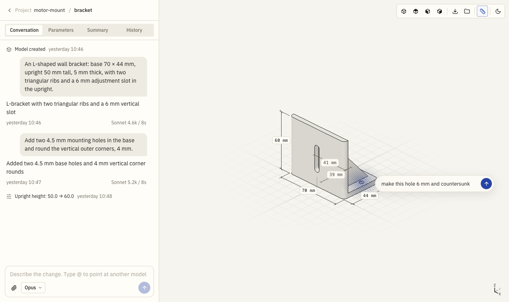
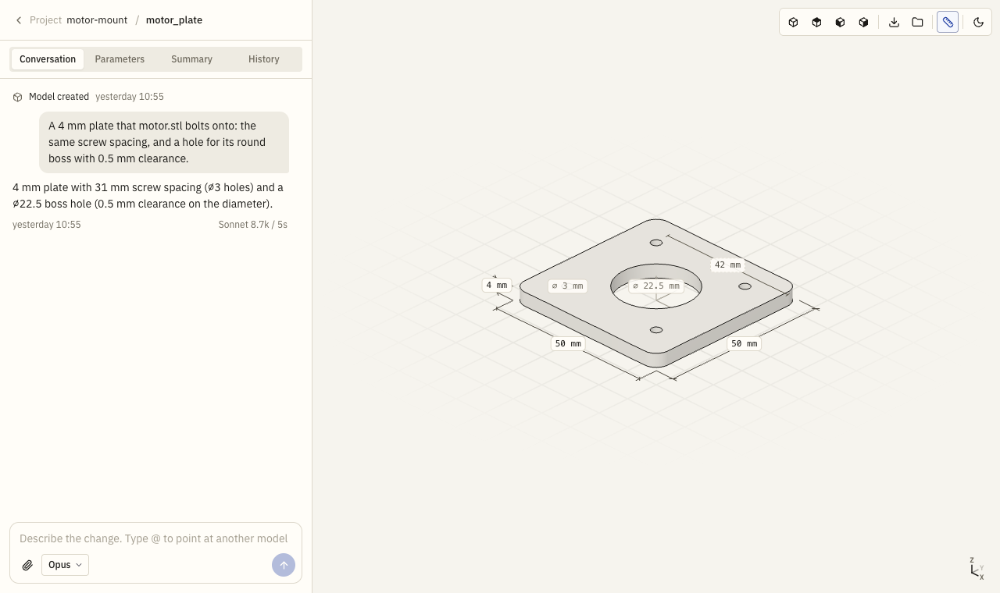
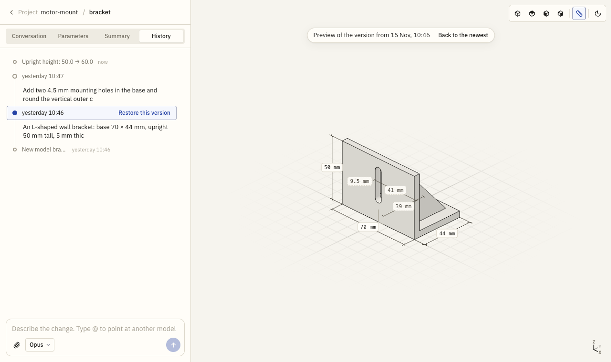
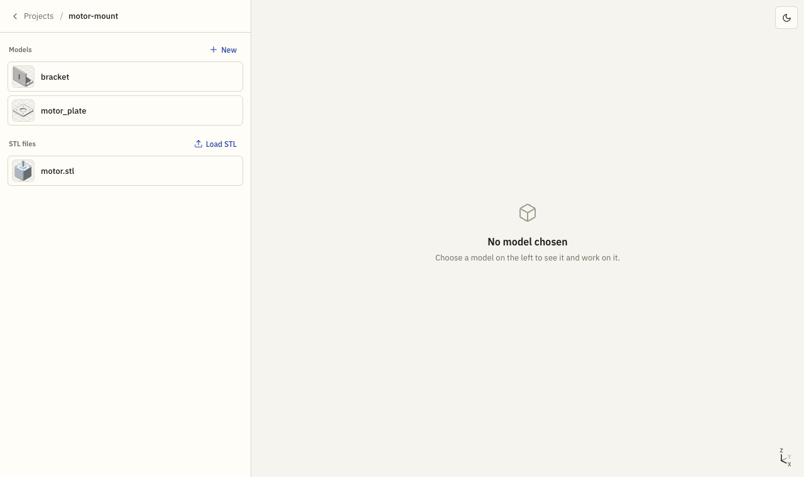

<h1 align="center">QuiCAD</h1>

<p align="center">
  A prompt-driven CAD editor. Describe a part and get a parametric model<br>
  you can print, in a few seconds, on your own machine.
</p>

<h3 align="center">
  Based on <a href="https://github.com/gumyr/build123d">build123d</a>
  and <a href="https://github.com/cyberchitta/cad-khana">cad-khana</a>
</h3>

QuiCAD is a small local web app: the conversation on the left, the 3D model
on the right. Every model is a plain [build123d](https://github.com/gumyr/build123d)
Python file, checked the [cad-khana](https://github.com/cyberchitta/cad-khana)
way while it is built, so the result is real, parameterized, editable CAD with
STL export. The modeling is done through the
[Claude Code](https://claude.com/claude-code) or
[Codex](https://developers.openai.com/codex/cli) CLI you already have, on your
subscription. There is no other account, key or cloud.

## What it does

<table>
<tr>
<td width="50%" valign="top">
<b>Create a part from a prompt</b><br><br>

</td>
<td width="50%" valign="top">
<b>Change it with another prompt</b><br><br>

</td>
</tr>
<tr>
<td width="50%" valign="top">
<b>Point at the spot with a right-click</b><br><br>

</td>
<td width="50%" valign="top">
<b>Take what you need from an STL</b><br><br>

</td>
</tr>
<tr>
<td width="50%" valign="top">
<b>Go back in time</b><br><br>

</td>
<td width="50%" valign="top">
<b>Keep models and STL files together</b><br><br>

</td>
</tr>
</table>

## Getting started

You need `python3`, `git`, and the Claude Code or Codex CLI, signed in with
your subscription (the editor uses whichever is signed in on your computer).
Nothing else: no Node, no packages to install by hand. Works on macOS and Linux.

```sh
git clone https://github.com/ppietak/QuiCAD.git
cd QuiCAD
./start    # starts the editor and opens it in the browser
```

The first start installs build123d into `.data/venv`, which takes about a
minute. Your projects are folders in `projects/`, each its own git repository.

## Good to know

- The app never touches your credentials and listens on 127.0.0.1 only.
- Turns run on your subscription. An API key found in the environment
  (`ANTHROPIC_API_KEY`, `OPENAI_API_KEY`) is not passed to the CLI, so nothing
  is billed per use by surprise; `./start --api-keys` passes it on.
- A model is Python code and runs on your computer when it is built. It runs
  fenced in: it can use only the files of its own project, start no programs
  and reach no network (on macOS the system sandbox enforces this too). Still,
  open only projects you trust.

## License

[Apache 2.0](LICENSE)
